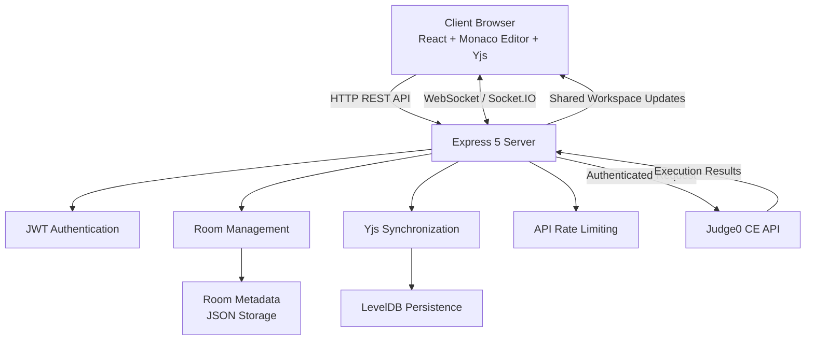

# Code Together

<p align="center">
  <strong>A Real-Time Collaborative Code Editor</strong>
  <br />
  Build, collaborate, and execute code together in real time.
  <br /><br />
  <a href="https://collab-code-editor-k4l1.onrender.com/">
    
  </a>
  <a href="https://github.com/Sai-Likitha-Madisetty/collab-code-editor">
    
  </a>
</p>

<p align="center">
  
  
  
  
  
  
</p>

---

## Overview

**Code Together** is a real-time collaborative code editor designed for pair programming, remote technical interviews, and shared problem-solving.

The platform allows multiple developers to join a shared coding workspace, edit code simultaneously, track participants, and execute programs across multiple programming languages.

Built with React, Monaco Editor, Yjs, Socket.IO, and Node.js, the application combines conflict-free document synchronization, secure room-based authentication, and remote code execution into a unified collaborative development environment.

Each workspace is accessible through a unique room code and shareable invitation link, making collaborative coding accessible without requiring complex setup.

## Key Features

- **Real-Time Collaborative Editing:** Multiple participants can edit the same document simultaneously using Monaco Editor and Yjs CRDT-based synchronization.
- **Live Participant Presence:** Displays active participants and supports remote cursor and selection tracking.
- **Multi-Language Code Execution:** Executes JavaScript, TypeScript, Python, C++, Java, and Go through the Judge0 CE API.
- **Private Coding Workspaces:** Supports optional password-protected rooms with bcrypt-based password hashing.
- **Room-Based Access:** Generates unique six-character room codes and shareable invitation links.
- **Secure Session Authentication:** Uses JSON Web Tokens (JWT) to authenticate room access and collaborative WebSocket connections.
- **Synchronized Workspace Settings:** Shares programming language configurations and execution results across connected participants.
- **Persistent Document Storage:** Uses LevelDB-backed Yjs persistence and JSON-based room metadata storage.
- **Responsive User Interface:** Provides a responsive landing page and coding workspace, including a mobile-friendly output sheet.
- **Production-Ready Architecture:** Uses a single-service deployment model in which Express serves the compiled frontend application.
- **Containerized Deployment:** Includes a multi-stage Dockerfile for building and deploying the complete application.

---

## Tech Stack

### Frontend

<p>
  
</p>

| Technology | Purpose |
| :--- | :--- |
| React 19 | Component-based user interface |
| Vite 7 | Frontend development and build tooling |
| Tailwind CSS 4 | Utility-first styling |
| Monaco Editor | Code editing environment |
| Yjs | Conflict-free collaborative document synchronization |
| y-monaco | Monaco Editor and Yjs integration |
| y-socket.io | Real-time document synchronization |
| React Router DOM | Client-side navigation |
| Lucide React | Interface icons |

### Backend

<p>
  
</p>

| Technology | Purpose |
| :--- | :--- |
| Node.js | JavaScript runtime environment |
| Express 5 | Backend server and REST API |
| Socket.IO | Real-time bidirectional communication |
| y-socket.io | Collaborative document transport |
| Yjs | Shared document state management |
| bcryptjs | Password hashing |
| JSON Web Tokens | Room session authentication |
| Express Rate Limit | API request rate limiting |
| LevelDB | Persistent collaborative document storage |

### Integrations & Infrastructure

<p>
  
</p>

| Technology | Purpose |
| :--- | :--- |
| Judge0 CE API | Remote code execution |
| Docker | Containerization and production builds |
| Render | Application deployment |
| Git | Version control |
| GitHub | Source code hosting |

---

## System Architecture

Code Together follows a client-server architecture that combines REST APIs and WebSocket communication to support collaborative editing, authentication, and remote code execution.



### Architecture Components

**1. Client Application**

The React frontend provides the collaborative coding interface using Monaco Editor. Yjs maintains shared document state, while Socket.IO enables real-time communication between participants.

**2. Backend Services**

The Express backend manages:

- Room creation and joining.
- Password verification.
- JWT generation and validation.
- Authenticated room access.
- Code execution requests.
- Static frontend asset delivery.

**3. Real-Time Synchronization**

Yjs provides conflict-free collaborative editing through CRDTs.

The y-socket.io integration maintains synchronized document state across connected clients.

The application uses three shared workspace structures:

| Shared State | Responsibility |
| :--- | :--- |
| `monaco` | Stores and synchronizes the collaborative editor content. |
| `settings` | Synchronizes workspace configurations, including programming language selection. |
| `run` | Shares the latest code execution results with connected participants. |

**4. Authentication & Authorization**

- Unique six-character room identifiers.
- Optional password-protected workspaces.
- bcrypt-based password hashing.
- JWT-based room session authentication.
- Twelve-hour room session token expiry.
- WebSocket authentication before document synchronization.

**5. Persistent Storage**

Room metadata is stored in JSON format, while Yjs collaborative document states are maintained using LevelDB persistence.

This enables workspace data recovery when the application restarts, provided the underlying storage is persistent.

---

## Supported Programming Languages

Code Together integrates with the Judge0 CE API to execute programs in multiple programming languages.

| Programming Language | Execution Support |
| :--- | :---: |
| JavaScript | Yes |
| TypeScript | Yes |
| Python | Yes |
| C++ | Yes |
| Java | Yes |
| Go | Yes |

Execution results, including program output, compilation errors, execution status, time, and memory information when returned by Judge0, can be shared across participants in the same workspace.

---

## Project Structure

```text
collab-code-editor/
│
├── Backend/
│   ├── data/
│   │   ├── rooms.json
│   │   └── yjs/
│   │
│   ├── public/
│   ├── scripts/
│   ├── .env
│   ├── package.json
│   └── server.js
│
├── Frontend/
│   ├── public/
│   ├── src/
│   │   ├── components/
│   │   ├── App.jsx
│   │   └── main.jsx
│   │
│   ├── package.json
│   └── vite.config.js
│
├── Dockerfile
├── .dockerignore
├── .gitignore
├── package.json
└── README.md
```

---

## Getting Started

Follow the instructions below to set up and run Code Together locally.

### Prerequisites

Ensure the following tools are installed:

- Node.js 20.0.0 or higher
- npm
- Git

### 1. Clone the Repository

```bash
git clone https://github.com/Sai-Likitha-Madisetty/collab-code-editor.git

cd collab-code-editor
```

### 2. Configure the Backend

Open a terminal and navigate to the backend directory.

```bash
cd Backend

npm install

npm run dev
```

The backend development server starts on port `3000`.

The first development startup automatically generates a secure, random `JWT_SECRET` inside `Backend/.env` if one does not already exist.

To generate a secret manually:

```bash
node -e "console.log(require('node:crypto').randomBytes(32).toString('hex'))"
```

Keep the generated secret private.

### 3. Configure the Frontend

Open a second terminal window from the project root.

```bash
cd Frontend

npm install

npm run dev
```

The Vite development server will normally be available at:

```text
http://localhost:5173
```

### 4. Access the Application

Open the following URL in your browser:

```text
http://localhost:5173
```

The frontend communicates with the backend through Vite's development proxy:

| Endpoint | Destination |
| :--- | :--- |
| `/api` | Express backend |
| `/socket.io` | Socket.IO backend |

The backend runs on port `3000`.

---

## Environment Variables

Configure the following variables in `Backend/.env`.

| Variable | Required | Default | Description |
| :--- | :---: | :--- | :--- |
| `JWT_SECRET` | Yes | None | Private signing key for room session authentication. Must contain at least 32 characters. |
| `JUDGE0_URL` | No | `https://ce.judge0.com` | Base URL of the Judge0 CE code execution service. |
| `PORT` | No | `3000` | Port used by the HTTP and Socket.IO servers. |
| `FRONTEND_ORIGIN` | No | `*` | Allowed browser origin configuration for Socket.IO connections. |

### Example Configuration

```env
JWT_SECRET=your_secure_random_secret_of_at_least_32_characters
JUDGE0_URL=https://ce.judge0.com
PORT=3000
FRONTEND_ORIGIN=*
```

**Important:** Never commit `.env` files, JWT secrets, or other sensitive credentials to GitHub.

The `.env` file and local backend data directory should remain excluded from version control.

---

## Production Deployment

Code Together is deployed on **Render** using its Docker-based production configuration.

### Live Application

<p align="center">
  <a href="https://collab-code-editor-k4l1.onrender.com/">
    
  </a>
</p>

**Deployment URL:** https://collab-code-editor-k4l1.onrender.com/

### Deployment Architecture

The production deployment uses a single-service architecture:

1. Docker builds the React frontend using Vite.
2. The backend dependencies are installed in a separate build stage.
3. The compiled frontend assets are copied into the backend's `public` directory.
4. Express serves the frontend application and backend API from the same service.
5. Socket.IO handles real-time communication.
6. Judge0 CE handles remote code execution.

### Render Configuration

The repository includes a production Dockerfile.

For a Docker-based Render deployment:

- Connect the GitHub repository to Render.
- Select the Docker runtime.
- Use the repository root as the build context.
- Configure the required environment variables.
- Set the health check path to `/health`.
- Deploy the application.

The application uses the `PORT` environment variable supplied by the hosting platform.

**Persistent Storage:** The backend stores room metadata and Yjs document states under `/app/data` in the production container. Configure a Render persistent disk mounted at `/app/data` if persistent workspace storage is required. Without persistent storage, container filesystem data may be lost during replacement or redeployment.

---

## Docker Deployment

The project includes a multi-stage Dockerfile that builds and packages the frontend and backend into a single production container.

### 1. Build the Docker Image

Run the command from the project root:

```bash
docker build -t code-together .
```

### 2. Configure Environment Variables

Ensure that `Backend/.env` contains a valid `JWT_SECRET` of at least 32 characters.

### 3. Run the Container

```bash
docker run \
  --env-file Backend/.env \
  -p 3000:3000 \
  -v code-together-data:/app/data \
  code-together
```

### 4. Access the Application

```text
http://localhost:3000
```

The named Docker volume `code-together-data` preserves room metadata and Yjs document storage across container restarts.

---

## Security & Reliability

Code Together incorporates several backend security and reliability measures:

- **Password Security:** Optional room passwords are hashed using bcryptjs.
- **Session Authentication:** JWTs protect room-specific API requests and WebSocket connections.
- **Room Authorization:** Authenticated sessions are validated against the requested room identifier.
- **Rate Limiting:** Limits repeated room-joining attempts and code execution requests.
- **Input Validation:** Validates room details, programming language selection, and code submission size.
- **Execution Timeout:** Applies request timeouts when communicating with the Judge0 service.
- **Persistent Document Storage:** Uses LevelDB-backed Yjs persistence for collaborative document recovery when storage is retained.

---

## API & Health Check

The Express backend exposes the following core endpoints:

| Method | Endpoint | Purpose |
| :--- | :--- | :--- |
| GET | `/health` | Checks backend service health. |
| POST | `/api/rooms` | Creates a collaborative workspace. |
| POST | `/api/rooms/:id/join` | Joins an existing workspace. |
| GET | `/api/rooms/:id` | Retrieves authenticated room information. |
| POST | `/api/run` | Submits code for remote execution. |

Room-specific API operations require valid authentication credentials.

---

## Future Enhancements

Potential areas for further development include:

- Additional programming language support.
- Enhanced collaborative debugging tools.
- Improved workspace management.
- Extended session and activity history.
- Additional testing and monitoring capabilities.

---

---

<p align="center">
  <strong>Built for collaboration. Powered by code.</strong>
  <br />
  If Collab-Code-Editor made your coding experience better, consider giving this repository a star.
  <br />
  Every star helps this project reach more developers.
  <br /><br />
  <a href="https://github.com/Sai-Likitha-Madisetty/collab-code-editor">
    
  </a>
  <br /><br />
  <sub>One workspace. Multiple minds. Better code.</sub>
</p>

